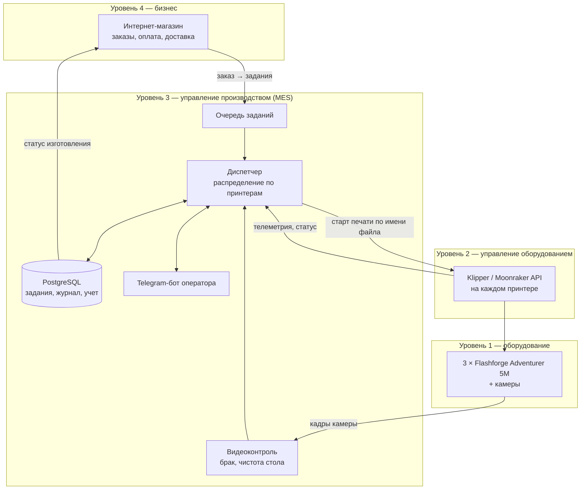
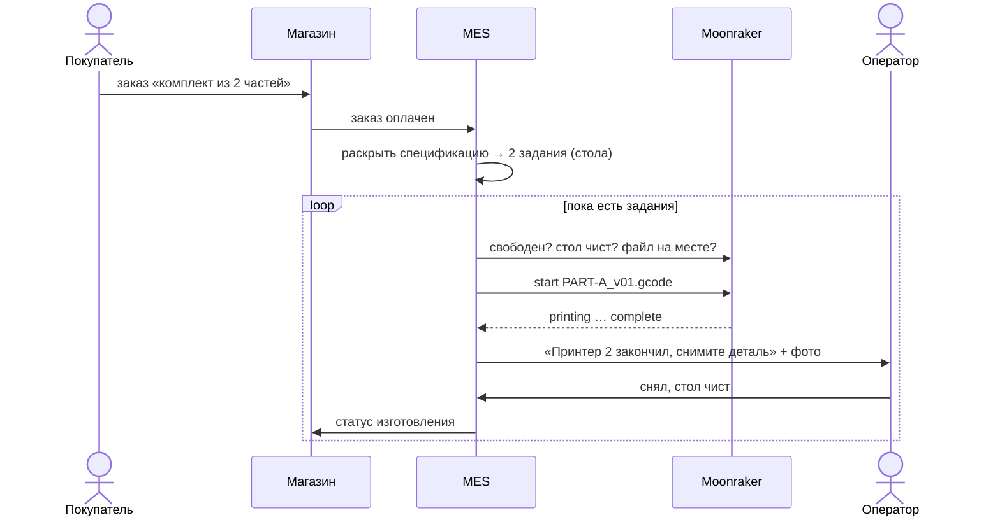
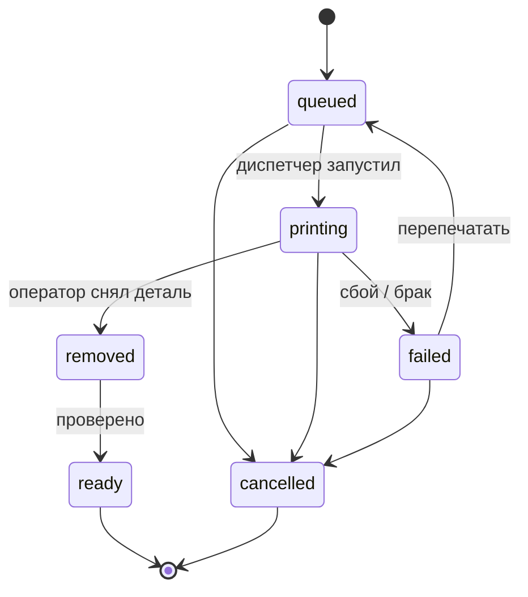

# print-farm-mes

Концепция системы диспетчерского управления небольшой фермой 3D-принтеров: заказ из интернет-магазина сам превращается в очередь печати, задания распределяются по свободным принтерам, а оператору остается снять деталь и подтвердить, что стол чист.

> **Статус: проектирование.** Здесь идея, архитектура и модели данных. Реализован первый кусок — бот уведомлений [printer-farm-bot](https://github.com/kovisw/printer-farm-bot), часть схемы БД уже есть в коде магазина (код магазина закрыт).

## Откуда задача

У меня три Flashforge Adventurer 5M (Klipper + Moonraker), на них печатаются пластиковые детали для моего интернет-магазина. Сейчас все руками:

- по каждому заказу сам решаю, какие файлы печатать и на каком принтере — легко запустить не тот файл или забыть позицию;
- что стоит в очереди, держу в голове;
- длинная печать может закончиться ночью, и принтер стоит до утра;
- нет учета: сколько времени и пластика ушло, сколько брака, когда пора обслуживать принтер.

Уведомления о завершении и сбоях уже решены ботом — это была первая боль. Дальше хочется убрать ручное «что и где запустить».

## Архитектура

Разложил систему по уровням стандарта ISA-95 (модель автоматизации производства):

## Как заказ становится печатью

Главное решение: **продается артикул, печатается стол.** Один G-code = один стол принтера. Товар может состоять из нескольких столов — например, комплект из двух частей печатается двумя столами, и при браке перепечатывается только один. Все G-code заранее лежат на принтерах, MES передает только имя файла.

## Задание на печать

Статус заказа не хранится отдельно, а считается из статусов его заданий: хотя бы одно печатается — «печатается», все готовы — «готов к отправке».

Принтер тоже живет по автомату: `idle → printing → awaiting_clearance → idle`. Пока оператор (или камера) не подтвердил чистый стол, новое задание на принтер не уйдет — это защита от печати поверх готовой детали.

## Что планируется

| Модуль | Что делает | Состояние |
|---|---|---|
| Уведомления | Завершение, ошибки, офлайн в Telegram | ✅ [printer-farm-bot](https://github.com/kovisw/printer-farm-bot) |
| Модель данных | Столы, спецификации, задания, журнал статусов, принтеры | ✅ спроектирована и покрыта тестами |
| Прием заданий | Заказ из магазина → задания в очередь | спроектирован |
| Диспетчер | Выбор принтера с учетом приоритета, длительности и времени суток | идея, см. [docs/dispatch.md](docs/dispatch.md) |
| Управление печатью | Старт/пауза/отмена и телеметрия через Moonraker | частично есть в боте |
| Видеоконтроль | Брак во время печати, проверка чистоты стола (OpenCV / Obico) | идея |
| Учет | Время, пластик, брак, наработка для ТО | поля в БД есть |

Подробнее: [docs/data-model.md](docs/data-model.md) — модель данных, [docs/dispatch.md](docs/dispatch.md) — как диспетчер выбирает принтер.

## Стек

Python, FastAPI, SQLAlchemy 2 (async), PostgreSQL, Alembic, Klipper/Moonraker API, aiogram (Telegram), OpenCV.

## Похожие системы

Смотрел OctoFarm, SimplyPrint, 3DPrinterOS, Obico. Они хорошо управляют принтерами, но не знают про заказы: очередь там составляет человек. Мне нужна связка «заказ магазина → столы → принтеры», с учетом того, что один товар печатается несколькими столами.
