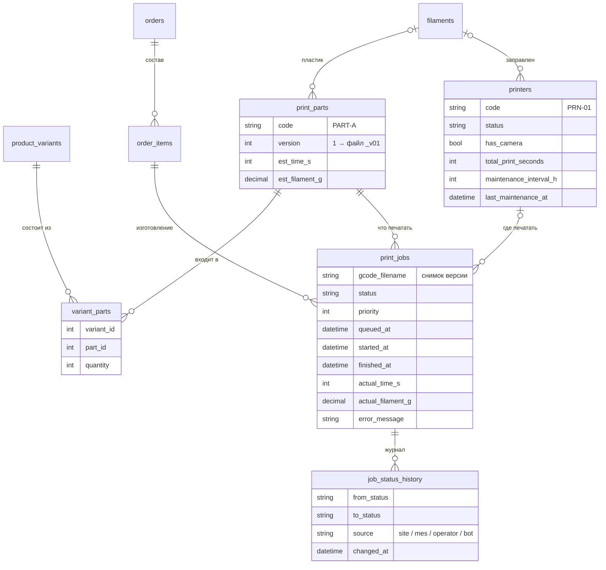

# Модель данных

Производственная часть схемы. Таблицы каталога и заказов магазина здесь показаны только там, где они связаны с производством.



## Решения

**Стол — единица производства.** `print_parts` — один G-code на стол принтера. `variant_parts` — спецификация: из каких столов и в каком количестве собирается товар. Заказ создает по заданию на каждый стол × количество.

```
Комплект из двух частей
  → PART-A   (первая часть)
  → PART-B   (вторая часть)
```

Новый товар из уже существующих столов не требует нового G-code — только спецификации.

**Версии файлов.** Имя файла на принтере — `КОД_vNN.gcode`. Изменилась модель или настройки печати — новая версия, старый файл не перезаписывается. Задание хранит имя файла, которым печаталось, поэтому видно, чем печатали каждый заказ, а уже поставленные задания допечатываются своей версией.

**Журнал статусов.** Каждый переход задания пишется в `job_status_history` вместе с источником (сайт, MES, оператор, бот). Переходы проверяются автоматом состояний, недопустимый переход — ошибка, повтор того же статуса игнорируется.

**Нет IP в базе.** У принтера в БД только код `PRN-01`. Сетевые адреса Moonraker живут в конфиге MES — база магазина не знает о сети фермы.

**Учет и ТО.** По заданиям копится фактическое время и расход пластика, по принтеру — наработка. Когда наработка с последнего ТО превышает интервал, принтер просится на обслуживание.
