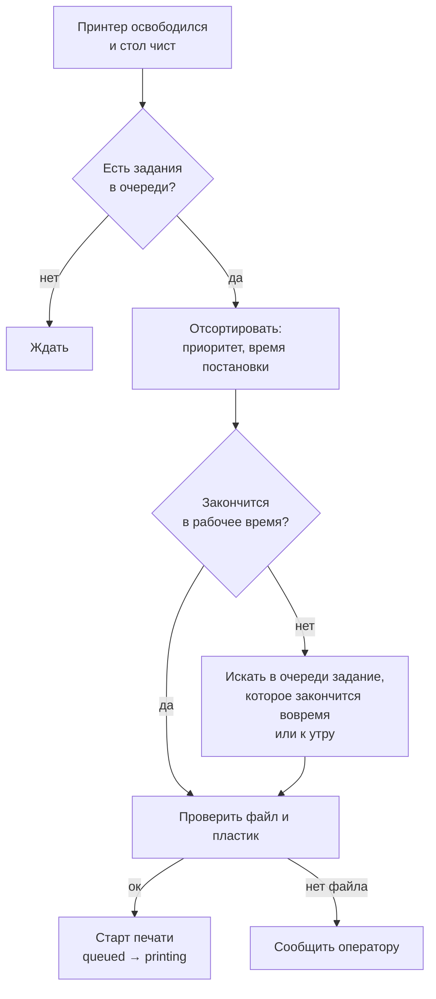

# Диспетчер: какое задание и на какой принтер

Черновик алгоритма. Пока не реализован.

## Когда принтер может взять задание

Все условия сразу:

- принтер онлайн и в статусе `idle`;
- стол подтвержден чистым (оператором в боте или камерой);
- нужный файл есть на принтере (`GET /server/files/list` в Moonraker);
- заправлен нужный пластик;
- принтер не на обслуживании.

Если файла нет — задание не запускается, оператор получает сообщение.

## Какое задание взять первым

1. Выше приоритет — раньше (срочный заказ, перепечатка брака).
2. При равном приоритете — кто раньше встал в очередь.
3. **Время суток.** Задание не должно закончиться, когда в мастерской никого нет: иначе готовая деталь стоит на столе до утра, а принтер простаивает. Окончание = сейчас + `est_time_s`. Если оно попадает в нерабочее окно — берем более короткое задание из очереди или, наоборот, длинное, которое как раз закончится к утру.

## Что делает оператор

После старта системы оператор:

1. получает в Telegram «Принтер 2 закончил» с фото стола;
2. снимает деталь и нажимает «Снял, стол чист»;
3. при браке — «Брак», задание уходит в `failed` и по решению оператора возвращается в очередь.

Все остальное — что печатать, где и когда — решает диспетчер.
